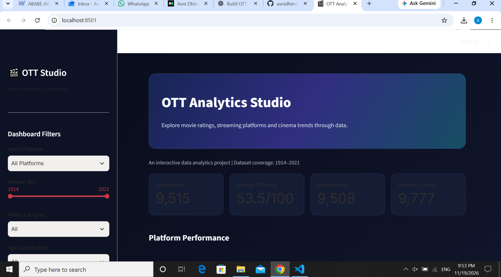
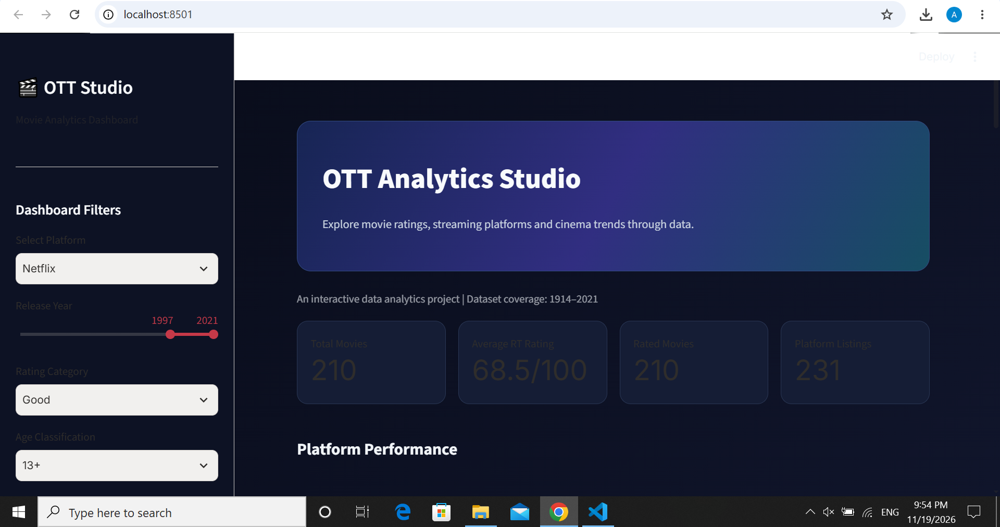
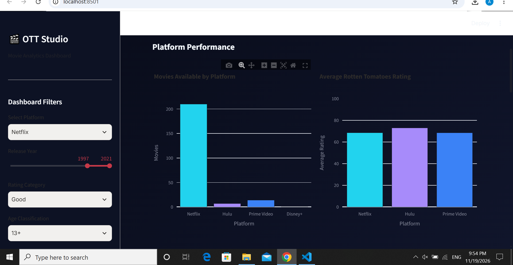
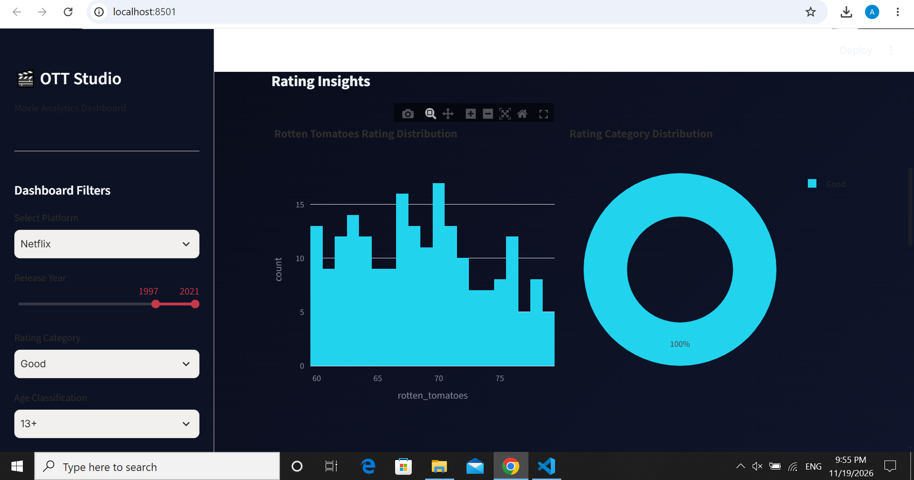
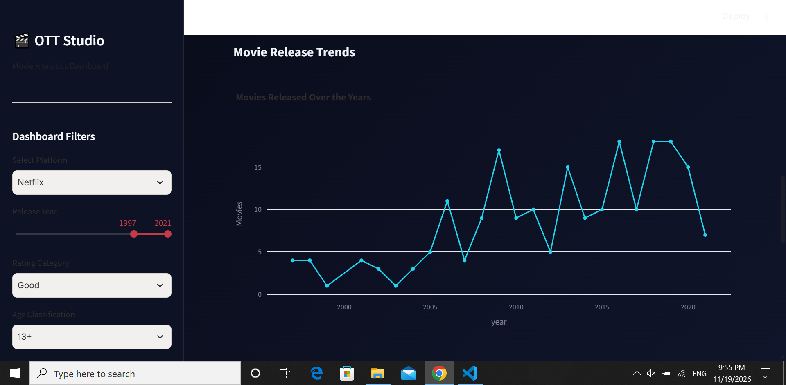
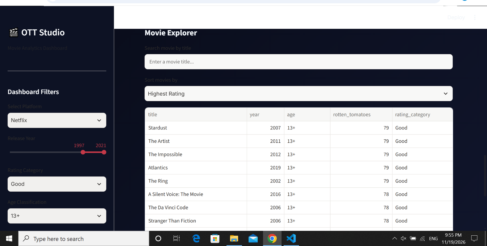
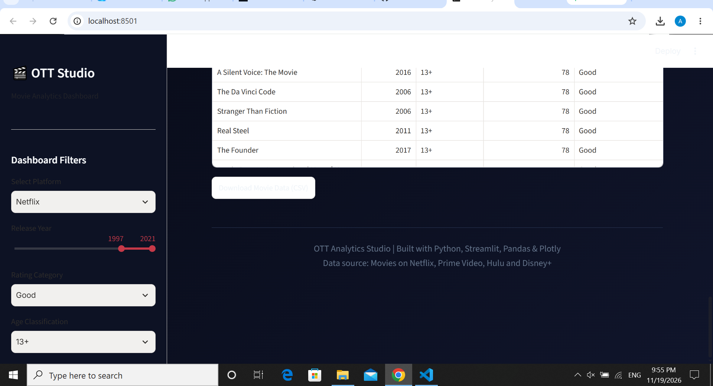

# OTT Analytics Studio

A data analytics dashboard built using Python and Streamlit to explore and analyze movies available across Netflix, Prime Video, Hulu, and Disney+.

The project focuses on platform-wise comparison, Rotten Tomatoes ratings, movie release trends, and interactive movie exploration.

## Dashboard Preview

### 1. Main Dashboard


### 2. Platform Analysis


### 3. Rating Analysis


### 4. Movie Release Trends


### 5. Movie Explorer


### 6. Interactive Filters


### 7. Additional Insights


## Project Overview

OTT Analytics Studio is an interactive data analytics project that explores a dataset of movies available across four major streaming platforms.

It transforms raw movie data into visual insights through charts, metrics, filters, and a searchable movie explorer.

## Features

- Interactive Streamlit dashboard
- Platform-wise movie comparison
- Rotten Tomatoes rating analysis
- Rating category distribution
- Movie release-year trends
- Interactive platform and year filters
- Age classification filtering
- Searchable movie explorer
- CSV export of filtered movie data
- Dark-themed dashboard interface

## Dataset

**Dataset:** Movies on Netflix, Prime Video, Hulu and Disney+

**Source:** [Kaggle Dataset](https://www.kaggle.com/datasets/ruchi798/movies-on-netflix-prime-video-hulu-and-disney)

The dataset contains 9,515 movie records and includes information such as movie titles, release years, age classifications, Rotten Tomatoes ratings, and streaming platform availability.

Dataset coverage in this version extends up to 2021.

## Technology Stack

- Python
- Pandas
- NumPy
- Streamlit
- Plotly
- Matplotlib
- Seaborn

## Project Structure

```text
OTT-Rating-Analysis/
│
├── dashboard/
│   └── app.py
│
├── dataset/
│   └── processed/
│       └── ott_cleaned.csv
│
├── screenshots/
│   ├── dashboard-home.png
│   ├── platform-analysis.png
│   ├── rating-analysis.png
│   ├── release-trends.png
│   ├── movie-explorer.png
│   ├── filters-view.png
│   └── additional-insights.png
│
├── src/
│   ├── clean_data.py
│   ├── analyze_data.py
│   └── inspect_data.py
│
├── visualizations/
│
├── requirements.txt
├── .gitignore
└── README.md
```

## Installation and Setup

### 1. Clone the repository

```bash
git clone https://github.com/avnidhiman2202/OTT-Rating-Analysis.git
```

### 2. Navigate to the project directory

```bash
cd OTT-Rating-Analysis
```

### 3. Create a virtual environment

```bash
python -m venv .venv
```

### 4. Activate the virtual environment

Windows:

```bash
.venv\Scripts\activate
```

### 5. Install dependencies

```bash
pip install -r requirements.txt
```

### 6. Add the dataset

Download the dataset from Kaggle and place the original CSV at:

```text
dataset/MoviesOnStreamingPlatforms.csv
```

Then run:

```bash
python src/clean_data.py
```

This generates the cleaned dataset required by the dashboard.

### 7. Run the dashboard

```bash
streamlit run dashboard/app.py
```

The dashboard will open in your browser.

## Key Dataset Findings

Based on the current dataset:

- Total movie records: 9,515
- Average Rotten Tomatoes rating: 53.55
- Oldest release year: 1914
- Latest release year: 2021

### Movies by Platform

| Platform | Movie Count |
|---|---:|
| Netflix | 3,695 |
| Prime Video | 4,113 |
| Hulu | 1,047 |
| Disney+ | 922 |

These findings describe this dataset and should not be interpreted as current platform catalog sizes.

## Learning Outcomes

Through this project, I explored:

- Data cleaning and preprocessing
- Exploratory Data Analysis (EDA)
- Data visualization
- Interactive dashboard development
- Python project organization
- Git and GitHub version control

## Author

**Avni Dhiman**

- GitHub: [avnidhiman2202](https://github.com/avnidhiman2202)
- LinkedIn: [avnidhiman2202](https://www.linkedin.com/in/avni-dhiman-296b71423/)

---

*Built as a learning project in Python, Data Analytics, and Streamlit.*